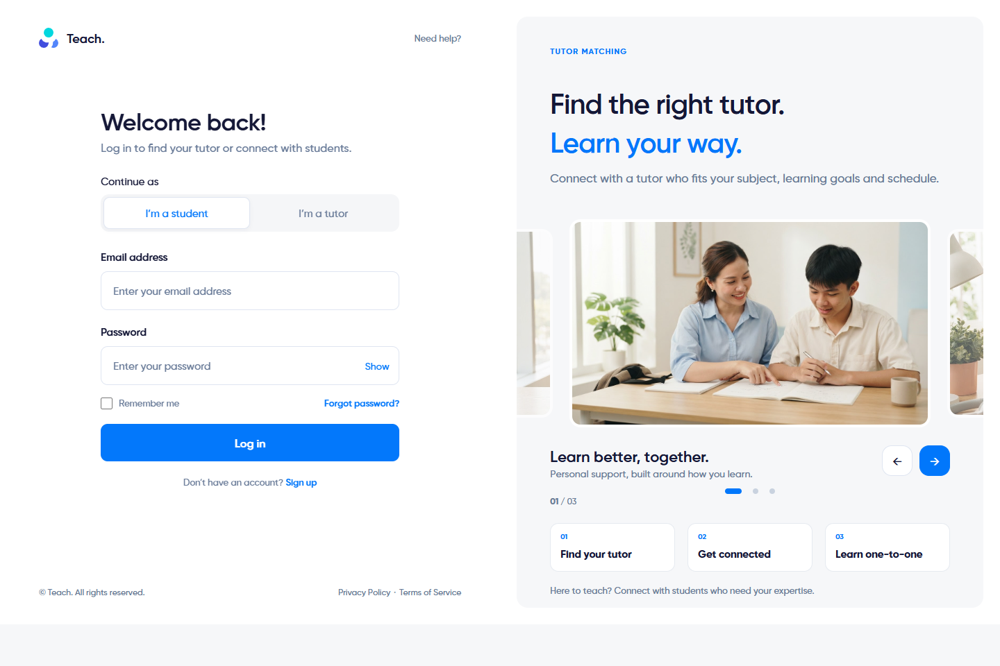
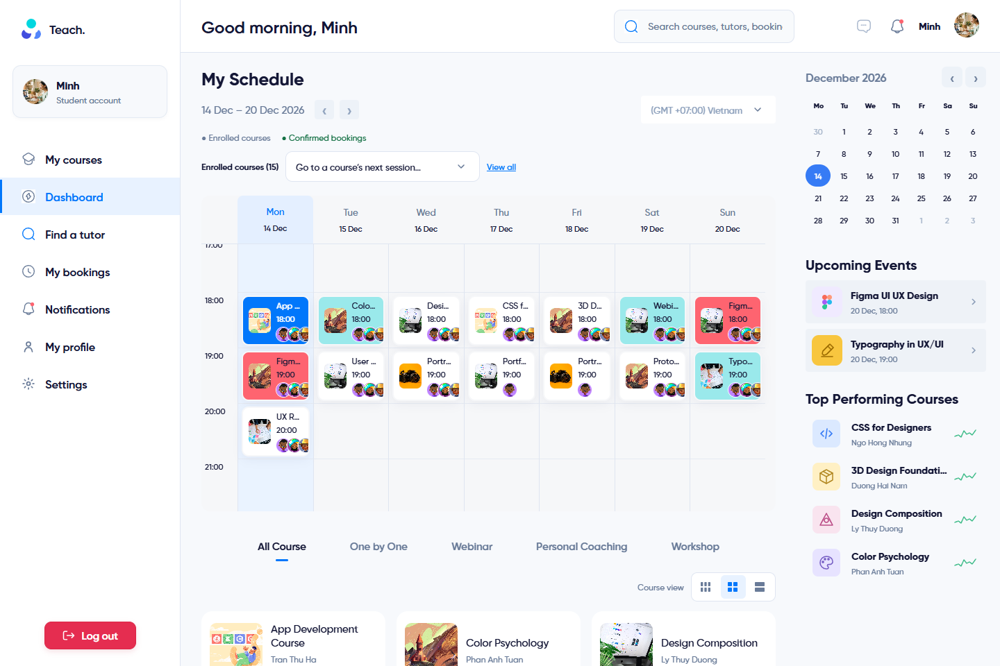
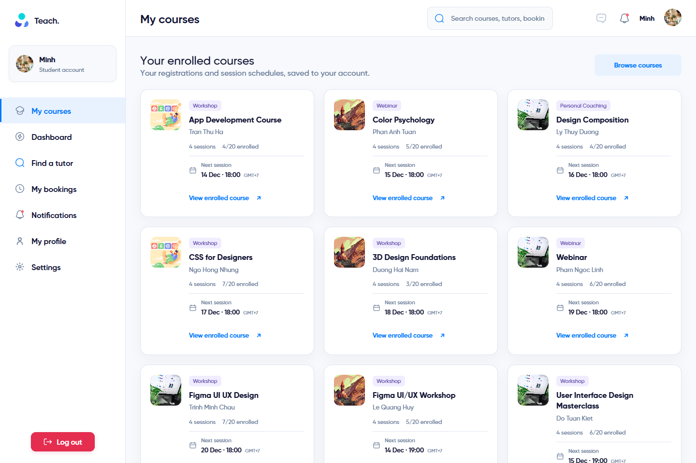
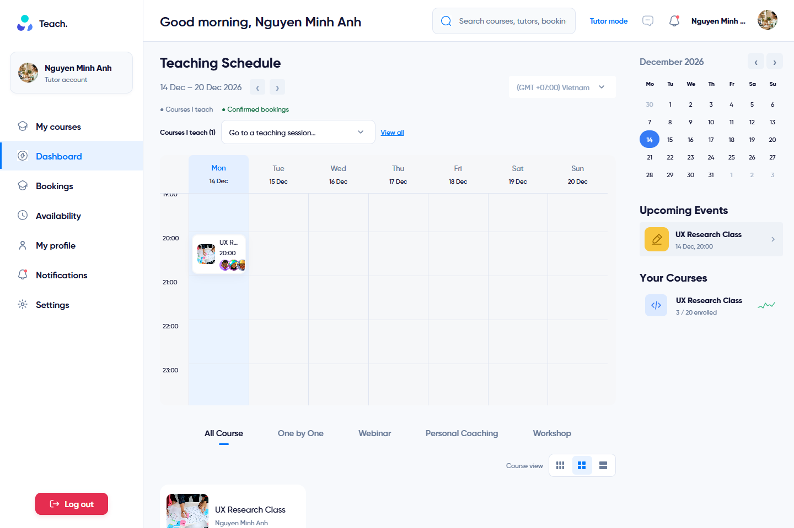
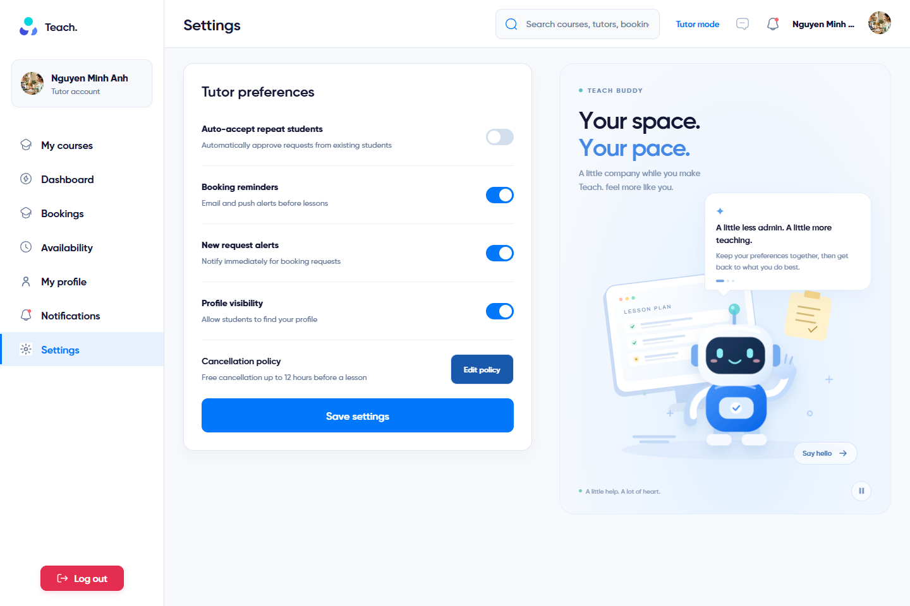

# TutorMatching · Teach.

Nền tảng ghép cặp gia sư và học sinh theo khung giờ, kết hợp đặt lịch 1–1, đăng ký khóa học và quản lý lịch dạy/học. Dự án triển khai **Hướng 4 — Scheduling & Time Constraints** với API Gateway, các microservice độc lập và Docker Compose.



## Chức năng chính

- **Student:** tìm gia sư theo môn và thời gian trống, giữ chỗ và xác nhận booking, đăng ký khóa học, xem khóa đã đăng ký và lịch học cá nhân.
- **Tutor:** xem lịch dạy và booking, cấu hình availability, xem khóa đang dạy và hồ sơ học sinh có liên quan.
- **Lịch:** hiển thị booking và session khóa học theo ngày/tuần, chọn ngày từ lịch nhỏ, đổi múi giờ và chuyển đến buổi học của khóa đã chọn.
- **Tương tác:** tìm kiếm có gợi ý, thông báo dropdown, toast, bộ lọc và chọn kích thước thẻ khóa học; điều hướng giữ nguyên app shell.
- **Ràng buộc:** kiểm tra trùng giờ của Tutor/Student, Redis hold có thời hạn, transaction và database constraint khi xác nhận.
- **Tác vụ nền:** Transactional Outbox, RabbitMQ, notification và reminder trước buổi học một giờ; retry hữu hạn và cơ chế phục hồi.

## Giao diện thực tế

Ảnh chụp từ ứng dụng chạy cục bộ bằng tài khoản demo, không phải ảnh mockup. Ngày hiển thị phụ thuộc dữ liệu seed và tuần được chọn.

### Lịch học của Student



### Khóa học đã đăng ký



### Lịch dạy của Tutor



### Cài đặt và Teach Buddy



## Kiến trúc và công nghệ

| Thành phần | Trách nhiệm | Instance trong bản demo HA |
|---|---|---:|
| API Gateway — YARP | Ingress API, xác thực và API Composition tìm tutor khả dụng | 1 |
| Identity Service | Tài khoản, JWT và refresh session | 1 |
| Tutor / Provider Service | Hồ sơ gia sư, môn học, availability, course và enrollment | 1 |
| Student / Consumer Service | Hồ sơ học sinh | 1 |
| Scheduling Service | Hold, booking, kiểm tra conflict và outbox | **3** |
| Notification / Reminder Service | Nhận event, thông báo và quét reminder chạy nền | 1 |

Frontend dùng **React 19, TypeScript, Vite**, font Gilroy và tài nguyên Figma lưu cục bộ. Backend dùng **.NET 10, ASP.NET Core, EF Core**. Mỗi service sở hữu PostgreSQL riêng; Redis lưu hold/khóa phối hợp, RabbitMQ truyền event, Mailpit nhận email demo. HAProxy điều phối request đến các Scheduling bằng `leastconn` và readiness checks.

Gateway tổng hợp thông tin Tutor với booked slots từ Scheduling để trả danh sách gia sư khả dụng. Quyết định xác nhận và chống trùng vẫn nằm trong service nghiệp vụ. Xem [API Composition](docs/coursework/api-composition.md).

## Khởi chạy bằng Docker Compose

Yêu cầu **Docker Desktop chạy Linux containers**, Docker Compose v2 và PowerShell nếu dùng script. Chạy trong thư mục gốc repository:

```powershell
# Chỉ tạo khi chưa có .env; không ghi đè password của volume hiện có.
if (-not (Test-Path .env)) { Copy-Item .env.example .env }
```

Đặt `JWT_SIGNING_KEY` trong `.env` thành khóa ngẫu nhiên tối thiểu 32 byte. Giữ `.env` ở máy cục bộ, không commit. Sau đó:

```powershell
./scripts/start-ha.ps1
```

Hoặc chạy trực tiếp, dùng cùng hai file cho mọi lệnh vận hành:

```powershell
docker compose -f compose.yaml -f compose.ha.yaml up -d --build --wait --wait-timeout 240
docker compose -f compose.yaml -f compose.ha.yaml ps
```

| Địa chỉ | Nội dung |
|---|---|
| [localhost:3000](http://localhost:3000) | Website |
| [localhost:8080/health/ready](http://localhost:8080/health/ready) | Gateway readiness |
| [localhost:8404](http://localhost:8404) | HAProxy stats |
| [localhost:8025](http://localhost:8025) | Mailpit — email demo |

`compose.yaml` đơn lẻ chạy một instance mỗi API để phát triển; `compose.ha.yaml` tăng riêng Scheduling lên ba. API nội bộ và database không publish cổng trong cấu hình demo. Dùng `compose.debug.yaml` khi cần cổng loopback để debug.

Dừng stack nhưng giữ dữ liệu:

```powershell
docker compose -f compose.yaml -f compose.ha.yaml stop
```

**Không dùng `down -v` nếu muốn giữ tài khoản, khóa học và booking.**

## Dữ liệu và tài khoản demo

Volume mới chưa có dữ liệu demo. Khi stack healthy, dùng Node.js 22 trở lên chạy theo thứ tự:

```powershell
node scripts/seed-demo.mjs
node scripts/seed-courses.mjs
node scripts/seed-demo-avatars.mjs
```

Các script gọi API thật để tạo/liên kết dữ liệu; đọc script trước khi chạy lại trên môi trường đã có dữ liệu. Nếu đang dùng volume demo hiện tại thì có thể đăng nhập ngay, không cần seed lại.

| Vai trò | Email | Mật khẩu demo |
|---|---|---|
| Student | `student01@demo.tutormatching.test` | `TutorDemo!2026` |
| Tutor | `tutor01@demo.tutormatching.test` | `TutorDemo!2026` |

Chọn đúng vai trò ở màn đăng nhập. Đây là tài khoản công khai cho demo cục bộ. Lịch course có ngày cố định trong seed; dùng danh sách khóa trên dashboard để chuyển tới session, không cần sửa ngày hệ thống.

## Phát triển và kiểm thử

Backend cần .NET 10 SDK; frontend cần Node.js 22 trở lên.

```powershell
dotnet build TutorMatching.slnx
dotnet test TutorMatching.slnx --no-build
```

Frontend:

```powershell
cd src/Web/TutorMatching.Web
npm ci
npm run dev
npm run test:run
npm run build
# Cần Docker stack đang chạy và Chrome đã cài:
npm run test:e2e:live
```

Kiểm tra tích hợp từ thư mục gốc, trên stack demo cục bộ:

```powershell
node scripts/audit-schedule.mjs
node scripts/verify-tutor-workflow.mjs
node scripts/verify-ha.mjs
python scripts/verify-database-recovery.py
```

`verify-ha` chủ động dừng một Scheduling rồi phục hồi để kiểm tra failover. Helper Python chạy kiểm tra rollback/claim worker với PostgreSQL thật qua proxy tạm. Các phép kiểm tra này không nên chạy trên hệ thống đang phục vụ người dùng thật.

## Tài liệu báo cáo

| Chủ đề | Tài liệu |
|---|---|
| Đối chiếu yêu cầu đề bài | [Phạm vi đồ án](docs/coursework/requirements-and-scope.md) |
| Tìm slot, giữ chỗ, chống trùng | [Thuật toán lập lịch](docs/coursework/scheduling-algorithms.md) |
| Tổng hợp dữ liệu tại Gateway | [API Composition](docs/coursework/api-composition.md) |
| Worker độc lập, nhắc lịch và retry | [Reminder/background jobs](docs/coursework/reminder-jobs.md) |
| Số instance và điều phối | [Instances & load balancing](docs/03-platform/instances-load-balancing.md) |
| Lỗi, retry và rollback | [Retry & recovery](docs/03-platform/retry-rollback-recovery.md) |
| Kịch bản trình bày | [Demo và kiểm chứng](docs/coursework/demo-and-verification.md) |
| Danh mục toàn bộ tài liệu | [Docs index](docs/README.md) |

## Các nhánh

- **[codex/scheduling-coursework](https://github.com/TrisMinh/TutorMatching/tree/codex/scheduling-coursework):** bản hiện tại dành cho đồ án Scheduling; giữ JWT, role/owner checks và nghiệp vụ, không cần triển khai PKI.
- **[codex/advanced-service-security](https://github.com/TrisMinh/TutorMatching/tree/codex/advanced-service-security):** bản lưu riêng các lớp bảo mật nâng cao trước khi rút gọn.

Ba Scheduling giúp tiếp tục phục vụ qua replica còn khỏe; request đang chạy có thể lỗi và cần retry theo quy tắc idempotency. Trạng thái phục hồi dựa trên database/Redis dùng chung. Gateway, broker và datastore vẫn là single instance trong demo; đây không phải triển khai HA toàn hệ thống hoặc cấu hình production.
