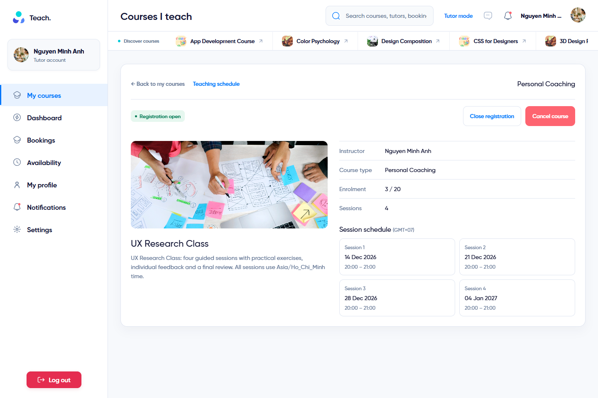

# Vòng đời khóa học

## Phạm vi

Tutor owner đóng/mở đăng ký hoặc hủy khóa; Student hủy đăng ký trước buổi đầu. 2FA và xóa tài khoản đã được loại khỏi phạm vi theo yêu cầu, không phải tính năng đang chờ triển khai. Không xử lý payment/refund.

## Trạng thái và thời gian

| Trạng thái | Nhận đăng ký | Lịch/reminder | Thao tác |
|---|---|---|---|
| Open, chưa bắt đầu | Có, còn chỗ và không trùng lịch | Hoạt động | Đóng đăng ký, hủy khóa; Student rút đăng ký |
| Closed, chưa bắt đầu | Không | Vẫn hoạt động cho người đã đăng ký | Mở lại, hủy khóa; Student rút đăng ký |
| In progress | Không, bất kể cờ Open/Closed cũ | Những buổi còn lại tiếp tục | Tutor hủy phần còn lại; Student không tự rút |
| Completed | Không | Chỉ giữ lịch sử | Không mở lại/hủy |
| Cancelled | Không | Loại khỏi lịch hoạt động và reminder | Không mở lại, giữ lịch sử và lý do |

Database lưu Open/Closed/Cancelled. InProgress/Completed là trạng thái trình bày tính từ UTC session hiện tại, không phụ thuộc một cron đổi trạng thái đúng giờ. Backend kiểm thời gian lại cho mọi mutation. Cancelled không xóa sessions/enrollments, chỉ giải phóng ràng buộc lịch hoạt động. Course cũ được migration gán Open/version 1, enrollment cũ vẫn active; không seed lại dữ liệu.

## API và quyền

- Tutor `PUT /api/v1/courses/{id}/status` với status, reason và version. Owner kiểm bằng JWT → TutorProfile → Course.TutorId. Sai role 403; Tutor khác 403; stale version 409.
- Student `DELETE /api/v1/courses/{id}/enrollments/me`: user ID từ JWT; rút đúng enrollment của mình. Soft withdrawal ghi WithdrawnAtUtc; count/capacity chỉ tính active. Sau first session 409.
- `POST /api/v1/courses/{id}/enrollments`: kiểm course Open, first session chưa bắt đầu, capacity, course khác và confirmed booking. Re-enroll tái kích hoạt row cũ và kiểm toàn bộ ràng buộc lại.
- API danh sách catalog loại Cancelled; detail vẫn truy cập để đọc lịch sử/lý do. Mine giữ cancelled courses của participant, bỏ withdrawn enrollment.

Đóng đăng ký không hủy lịch học. Hủy khóa cần lý do 1–300 ký tự, chỉ thực hiện khi còn session chưa kết thúc. Không xóa kết quả/học phần đã diễn ra. Đổi session của khóa đã có enrollment history bị chặn; chỉnh metadata với lịch giống nhau giữ nguyên session UUID để reminder không bị đứt reference.

## Transaction, cạnh tranh và retry

Course operations dùng global Redis schedule-write lock chung booking và transaction PostgreSQL Serializable. Enrollment/capacity, withdrawal, status và thông báo liên quan commit cùng nhau trong TutorDb; không truy vấn SQL xuyên database. Course.Version là concurrency token tăng mỗi lần thay đổi enrollment/course/state. Tranh chấp trả 409 hoặc schedule-busy 503, không vượt capacity.

Lặp hủy đăng ký trả 204; lặp status đã hiện hành trả thành công, không tạo thêm thông báo. Lặp enroll active trả enrolled=true, count không tăng. Tái đăng ký cập nhật enrollment notice hiện có theo unique course/student. UI chỉ tự retry thao tác được xác định idempotent, không tự replay status update có optimistic version.

## Thông báo và reminder

Hủy khóa ghi CourseLifecycleNotice cho từng active enrolled Student, có tên khóa, thời gian session còn lại, Tutor name/avatar và lý do. Withdrawal ghi notice cho Tutor. Tất cả notice có owner ID, API đọc/mark-read kiểm chính chủ; client ghép với notification booking và enrollment. Lỗi một nguồn không giấu nguồn còn dùng được, hiển thị trạng thái partial.

Bell và trang notification mở đúng course theo vai trò. Tắt in-app notifications vẫn giữ lịch sử database, API trả danh sách rỗng. Thông báo lifecycle hiện là **in-app**; không tuyên bố email hủy khóa.

Tutor internal reminder discovery không trả cancelled courses/withdrawn recipients. Sender hỏi lại trạng thái trước SMTP, suppress reminder cũ nếu course bị hủy hoặc người nhận không còn enrolled. Pending reminder có thể còn trong NotificationDb tới lúc xử lý rồi chuyển Cancelled; không cần distributed transaction để xóa nó ngay.

## Giao diện

Tutor: My courses → View session details → Close/Reopen registration hoặc Cancel course. Student: course detail → Cancel registration. Các thao tác đều có hộp xác nhận; hủy khóa cần lý do; toast sau response thành công. Badge Open/Closed/In progress/Completed/Cancelled có màu riêng. Catalog, lịch và ticker được refresh theo dữ liệu mới; giữ history ở My courses.

## Kiểm thử

- `node scripts/verify-course-lifecycle.mjs`: role/owner, version, close/reopen, capacity, active retry, withdrawal/re-enroll, conflict release, notice idempotency/owner/read, started/completed guards; fixture riêng được dọn trong finally.
- Playwright `tests/live/course-lifecycle.spec.ts`: thao tác thật Tutor/Student, withdrawal/re-enroll, cancel reason, lịch và đường dẫn thông báo, mobile.
- `ReminderRecipientTests`: cancelled/withdrawn/past/opt-out không chạm SMTP. Đây là unit với HTTP responses kiểm thử, không phải bằng chứng deliverability Internet.
- Dọn fixture UI bằng `node scripts/cleanup-lifecycle-ui-fixtures.mjs`, sau đó `audit-schedule.mjs` để đối chiếu dữ liệu demo.

Kiểm chứng ngày 15/11/2026: 60 test .NET, 89 test frontend; bộ live gồm 34 ca. Lượt hồi quy cuối có 33 ca qua, một ca vòng đời bị ảnh hưởng bởi lần redeploy Tutor (enroll đã 200, request reload mine nhận 503). Sau khi service ổn định, ca đó được chạy lại riêng và qua. Integration lifecycle trên Gateway/PostgreSQL thật cũng qua. Audit sau dọn fixture: 95 confirmed bookings, 0 course-booking conflicts. Các bằng chứng này không phải load benchmark hay đảm bảo SMTP exactly-once.
