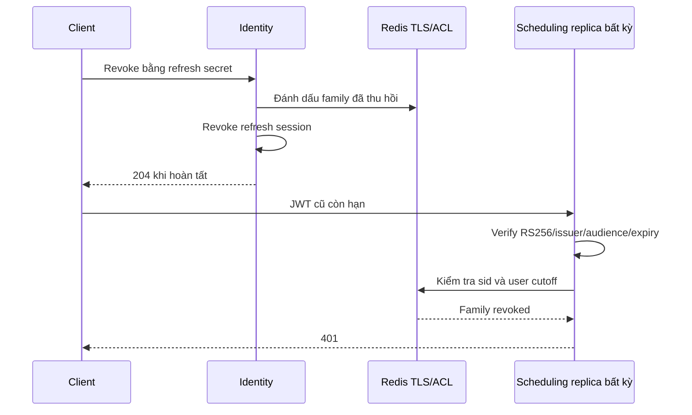

# Thu hồi access token và quản lý phiên

## Vấn đề của JWT chỉ kiểm chữ ký

Token 15 phút vẫn có thể dùng sau logout nếu API chỉ kiểm `exp`. Revoke refresh token chỉ ngăn lấy token mới; không tự vô hiệu access token đã phát. Yêu cầu khóa user ngay không thể giải quyết bằng “JWT là stateless nên không làm được”. Phải thêm trạng thái thu hồi hoặc introspection/version checking.

## Mô hình đã triển khai

JWT chứa `sid` (family của refresh session), `sub` và `issued_ms`. Sau khi kiểm chữ ký, **từng API và Gateway** đọc Redis:

| Redis key | Ý nghĩa | Thời hạn |
|---|---|---|
| `security:revoked:family:{sid}` | Cả access/refresh family bị thu hồi | 7 ngày + 1 phút theo refresh lifetime |
| `security:revoked:user:{sub}` | Cutoff thời điểm phát token của user | Access lifetime + 2 phút |

API từ chối token nếu family đã thu hồi, hoặc `issued_ms <= cutoff`. Redis ACL chỉ cho API đọc trạng thái thu hồi; **chỉ Identity được ghi** các key này. Không cache kết quả “chưa thu hồi” trong RAM một replica vì sẽ làm chậm hiệu lực thu hồi giữa ba Scheduling.

## Các thao tác

### Logout một phiên

Frontend hiện gọi `POST /api/v1/auth/revoke` với refresh token. Refresh token là bearer secret ngẫu nhiên nên endpoint này cho phép anonymous nhưng được throttle. Identity tìm hash, thu hồi family trong Redis rồi revoke refresh session trong database. Client xóa token cục bộ trong `finally`.

Khi Redis đã nhận lệnh thu hồi, access token cùng family bị từ chối trên các request xác thực tiếp theo của cả ba Scheduling. Không hủy một request đã được xác thực và đang thực thi trước thời điểm thu hồi. Nếu server không hoàn tất thao tác, không coi việc xóa localStorage là bằng chứng server đã revoke thành công.

### Thu hồi mọi phiên của chính mình

`POST /api/v1/auth/revoke-all` yêu cầu JWT hợp lệ. UserId lấy từ `sub`; không nhận target user tùy ý. Identity đặt cutoff, thu hồi các family đang lưu và revoke refresh sessions. Người dùng vẫn có thể đăng nhập mới bằng mật khẩu; revoke-all không phải khóa account.

### Khóa account khi phát hiện lộ quyền

`POST /api/v1/users/{userId}/disable` chỉ cho Admin: đặt trạng thái Disabled, cutoff user và thu hồi các family. Token cũ bị chặn; login/refresh tiếp theo không được phép. Không có public API đăng ký role Admin; tài khoản quản trị phải được cấp qua quy trình vận hành riêng. Khóa account không tự xóa/hủy lịch nghiệp vụ đã đặt.

### Refresh và reuse

Refresh rotation dùng transaction, khóa theo token family và row lock. Hai request dùng cùng refresh token: một thành công, request phát hiện reuse trả 401 và thu hồi family, bao gồm replacement đã phát. Đây là chính sách an toàn chặt; ứng dụng nhiều tab cần phối hợp refresh để không tự tạo tình huống reuse.

## Failure semantics

- Redis không truy cập được: token-validation fail closed, trả 503 thay vì cho phép đi tiếp. Readiness cũng đánh dấu dependency không khỏe.
- Redis dùng AOF và volume được giữ lại khi container khởi động lại. Nếu làm mất dữ liệu Redis/restore cache cũ, có nguy cơ mất dấu thu hồi; không được `FLUSHDB` hoặc xóa volume để “sửa lỗi”. Cần quy trình emergency invalidate/đổi key khi mất kho thu hồi.
- Database và Redis không tham gia distributed transaction. Ghi thu hồi trước giúp lỗi giữa chừng ưu tiên chặn access; nếu database chưa commit, API không báo thao tác khóa đã hoàn tất. Cần kiểm tra lại trạng thái khi vận hành.
- Cutoff dùng đồng hồ server; NTP/UTC cần ổn định. TTL được tính theo access lifetime hiện tại; đổi lifetime phải xem lại TTL thu hồi.

## Bằng chứng

`verify-security.mjs` dùng JWT còn hạn: đọc booking trực tiếp ở từng Scheduling thành công, gọi revoke, rồi yêu cầu trực tiếp cả ba replica đều 401. Kiểm tra refresh cũ 401, revoke-all chặn phiên khác và Admin disable chặn cả login lẫn access. Đây là kiểm thử trên Docker/TLS thực, không chỉ mock Gateway.
