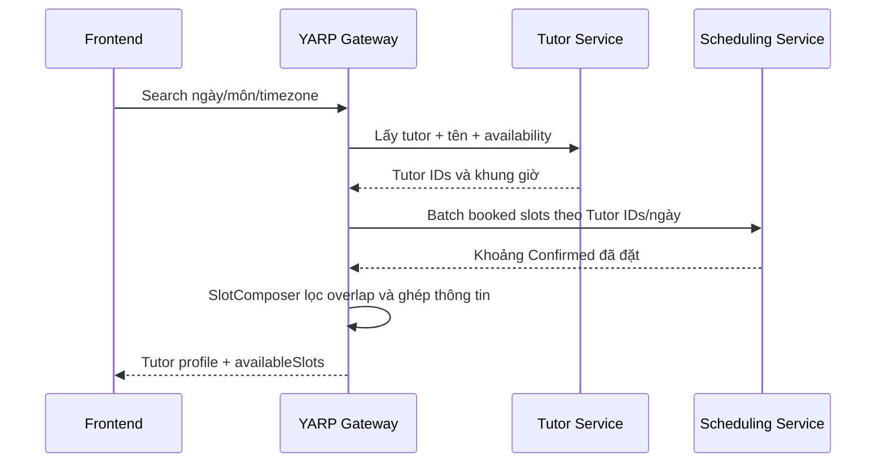

# API Composition tại Gateway

## Bài toán

Một service không sở hữu toàn bộ dữ liệu của màn tìm gia sư: Tutor biết tên, ảnh, môn và availability; Scheduling biết slot nào đã được đặt. Gateway là nơi tổng hợp response cho frontend, không thực hiện SQL join xuyên database.

Endpoint hiện hành: `GET /api/v1/search/available-tutors`, nhận subjectId, date, timezone, page, pageSize; yêu cầu Student JWT.

## Thứ tự và dữ liệu trả về

Hai lời gọi có phụ thuộc: phải có Tutor IDs trước rồi mới batch query Scheduling. Không mô tả chúng chạy song song khi code hiện tại không như vậy. Empty tutor list có thể trả ngay, không gọi Scheduling thừa.

Response gồm tên/ảnh/bio/experience/môn của Tutor cùng danh sách startAtUtc/endAtUtc khả dụng, pagination và generatedAtUtc. Đây là ví dụ thực tế của đề bài “lấy tên từ Provider và thời gian từ Scheduling rồi ghép lại”.

## Kiểm soát biên

Gateway truyền JWT người dùng cho service đích; core service vẫn kiểm quyền. Truy vấn slot batch giới hạn số Tutor/range để tránh response không giới hạn. Timezone được kiểm hợp lệ; ngày local chuyển thành cửa sổ UTC. Dependency không truy cập được trả 503 thay vì giả danh sách trống là không có tutor.

## Tách trách nhiệm

Gateway compose và lọc candidate để hiển thị; quyền quyết định booking cuối cùng vẫn ở Scheduling/Tutor và database constraints. UI không lấy kết quả search làm bằng chứng miễn kiểm tra conflict lần nữa. Nhánh này không có discovery/service mesh hay distributed transaction.

Các màn course/calendar còn gọi API course/enrollment/booking và kết hợp ở frontend. Không tuyên bố toàn bộ website đã gom vào một API schedule duy nhất; composition được minh chứng cụ thể ở endpoint search này.

## Demo khi chấm

Mở tìm Tutor theo ngày/môn, xem một response có cả tên và availableSlots. Đặt một slot rồi tìm lại để thấy slot bị loại. Dùng Gateway tests cho UTC/window/overlap và live test search; đối chiếu source `SearchComposition.cs`/`SlotComposer`.
