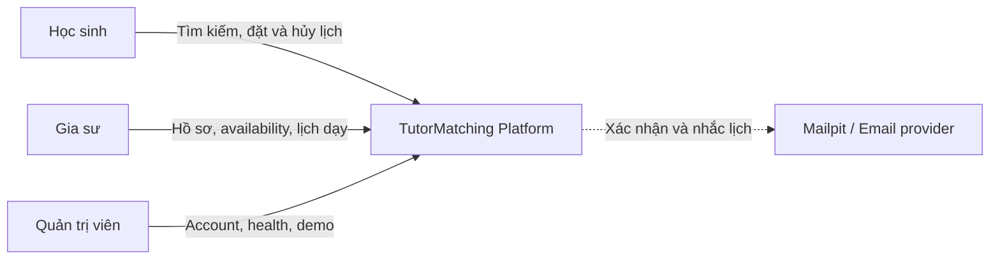
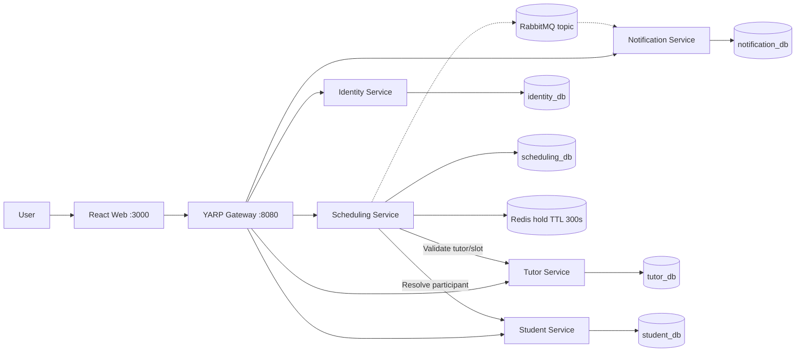
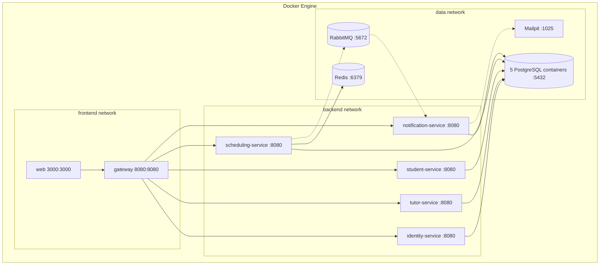
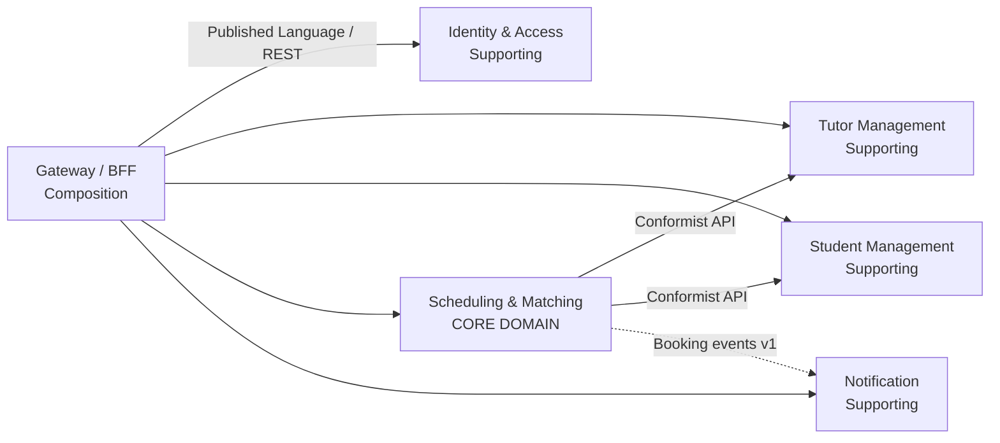

# Sơ đồ kiến trúc

Các sơ đồ trong trang này được viết bằng Mermaid và hiển thị trực tiếp trên GitHub. PlantUML tương ứng vẫn nằm cạnh trang này để làm nguồn kiểm tra chi tiết.

## System context

Nguồn: [`system-context.puml`](system-context.puml).

## Container architecture

Nguồn: [`container-architecture.puml`](container-architecture.puml).

## Docker Compose deployment

Nguồn: [`deployment-compose.puml`](deployment-compose.puml).

## DDD context map

Nguồn: [`ddd-context-map.puml`](ddd-context-map.puml).

