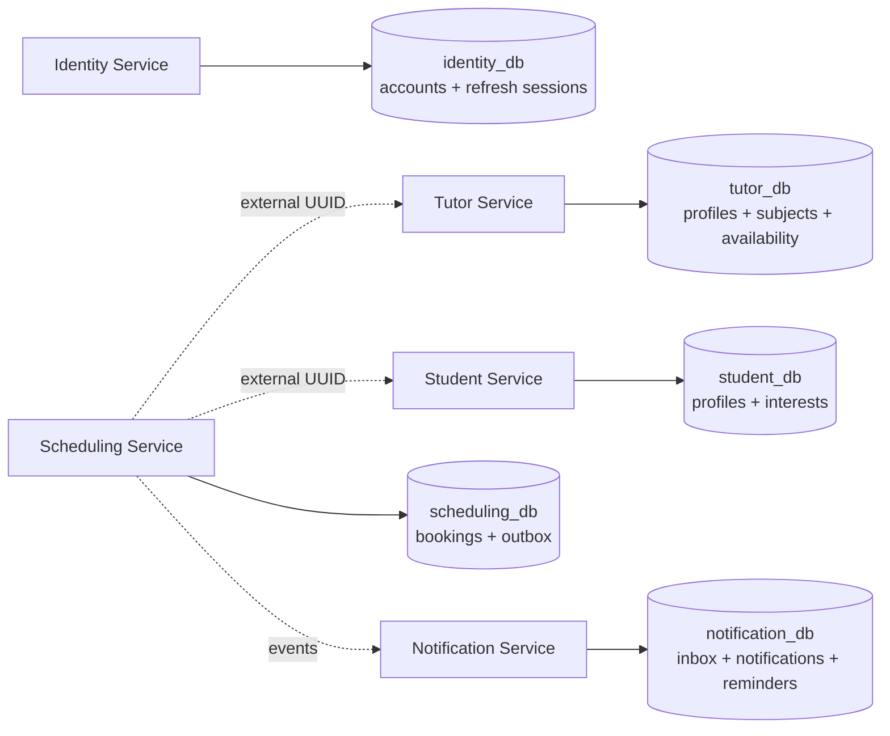
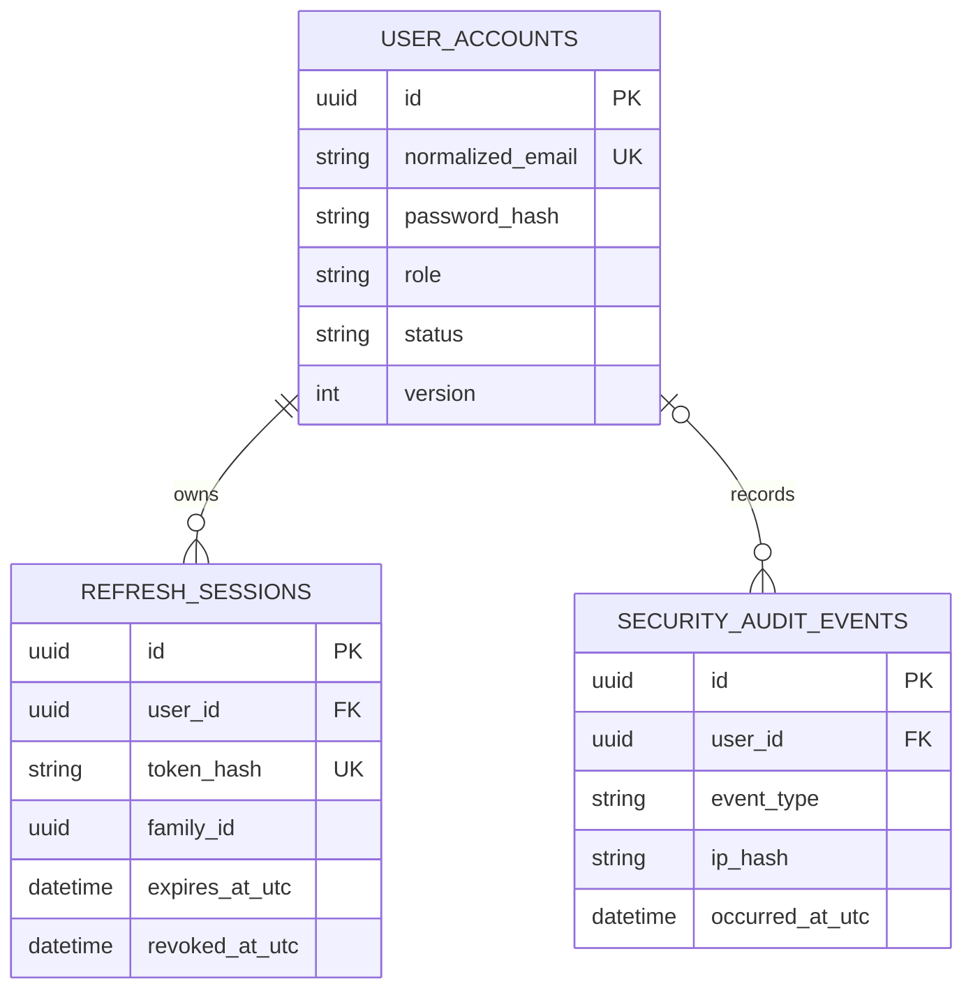
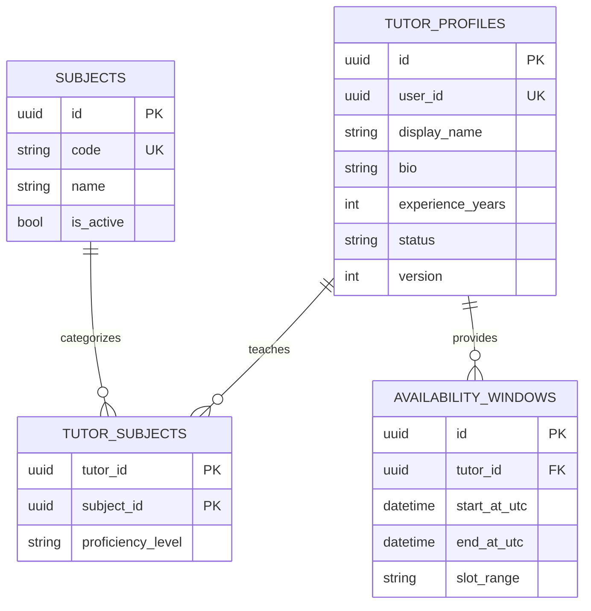
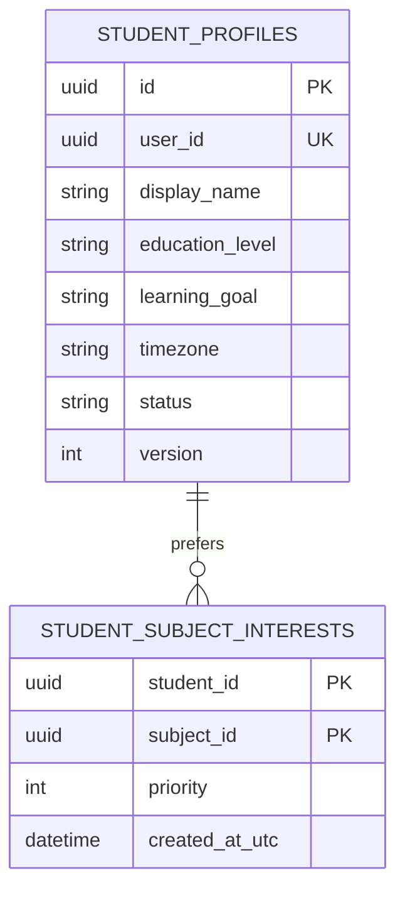
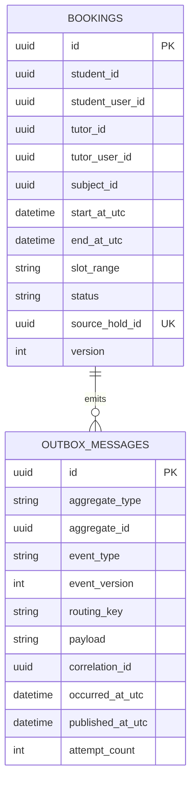
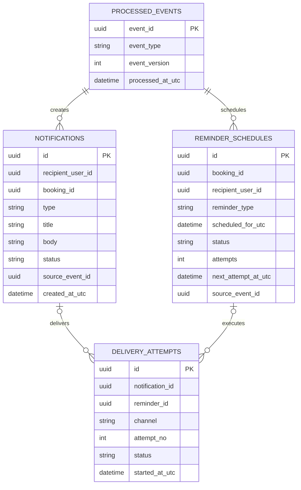

# Sơ đồ dữ liệu

Đường nối chỉ tồn tại trong phạm vi database sở hữu. UUID xuyên service là external reference, không phải foreign key liên database.

## Database ownership overview

Nguồn: [`database-erd.puml`](database-erd.puml).

## identity_db

Nguồn: [`identity-database-schema.puml`](identity-database-schema.puml).

## tutor_db

Nguồn: [`tutor-database-schema.puml`](tutor-database-schema.puml).

## student_db

Nguồn: [`student-database-schema.puml`](student-database-schema.puml).

## scheduling_db

Nguồn: [`scheduling-database-schema.puml`](scheduling-database-schema.puml).

## notification_db

Nguồn: [`notification-database-schema.puml`](notification-database-schema.puml).

