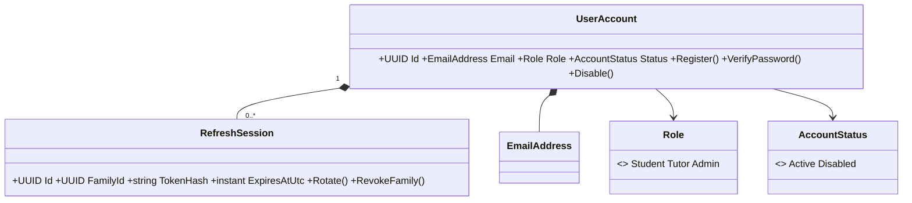
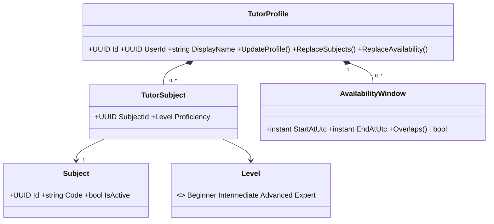
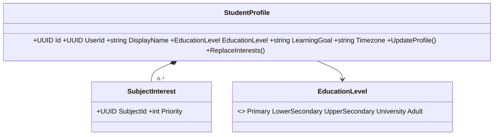
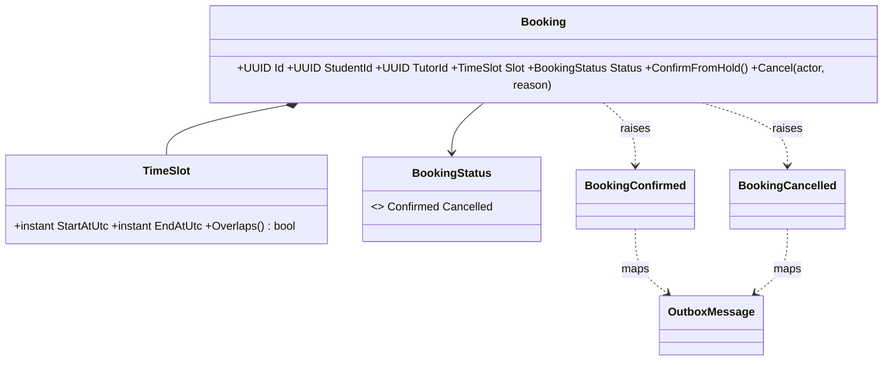
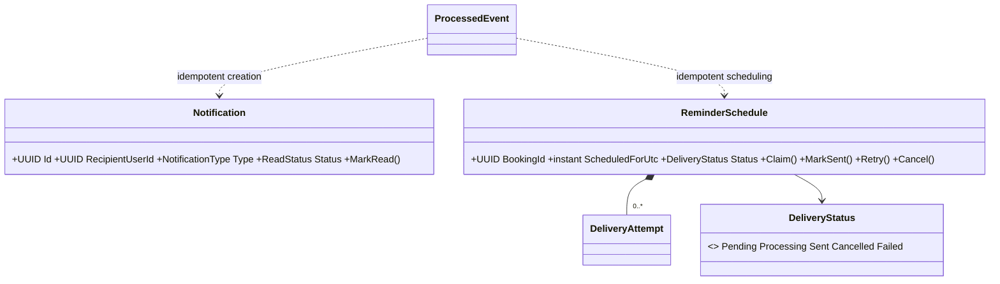

# Sơ đồ domain

## Identity domain

Nguồn: [`identity-domain.puml`](identity-domain.puml).

## Tutor domain

Nguồn: [`tutor-domain.puml`](tutor-domain.puml).

## Student domain

Nguồn: [`student-domain.puml`](student-domain.puml).

## Scheduling domain

Nguồn: [`scheduling-domain.puml`](scheduling-domain.puml).

## Notification domain

Nguồn: [`notification-domain.puml`](notification-domain.puml).

