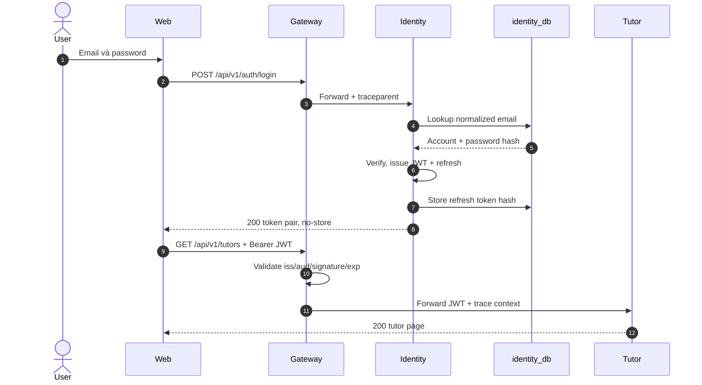
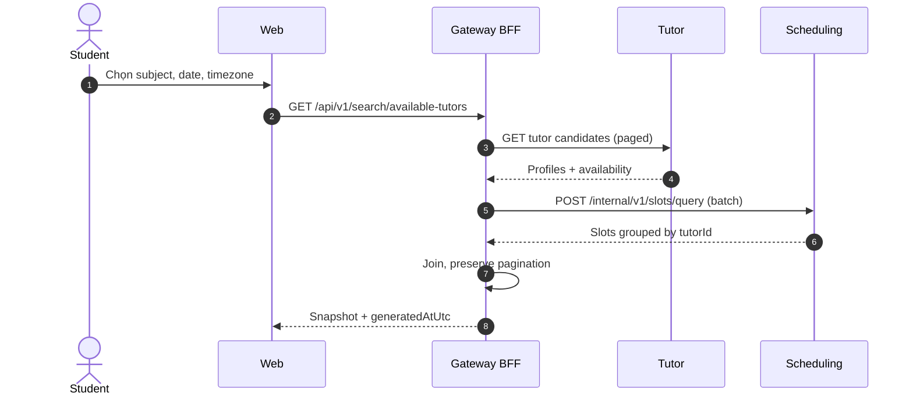
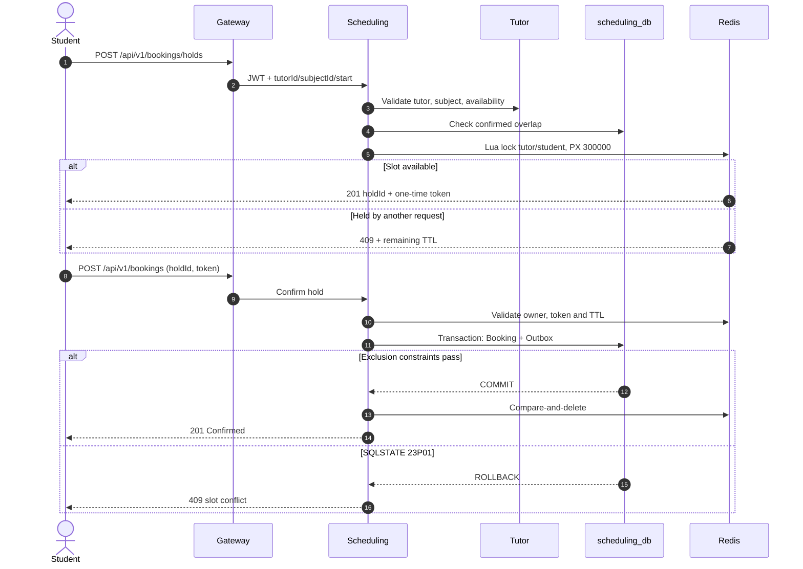
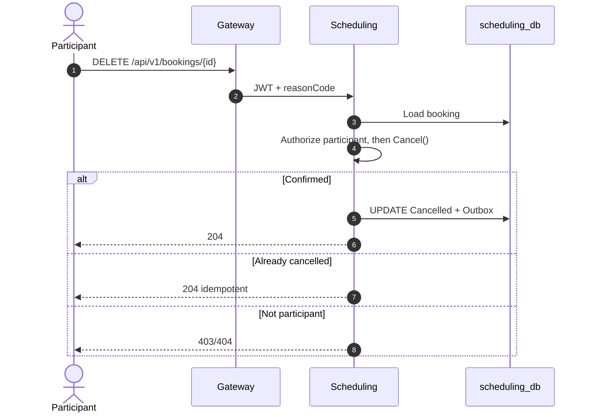
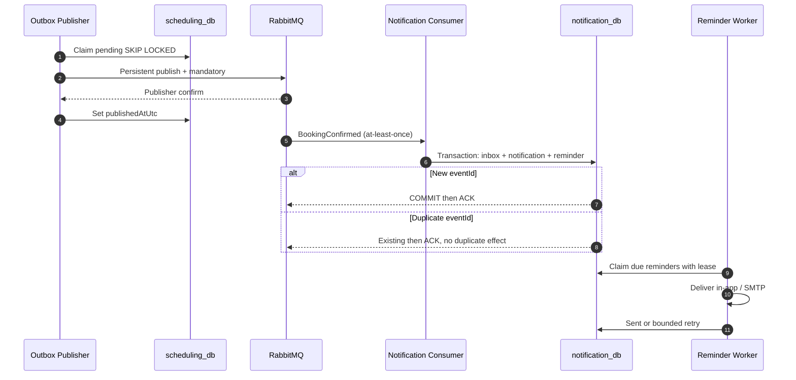

# Sơ đồ tuần tự

## Đăng nhập và gọi API có JWT

Nguồn: [`login-sequence.puml`](login-sequence.puml).

## Tìm gia sư còn lịch

Nguồn: [`search-sequence.puml`](search-sequence.puml).

## Giữ slot và xác nhận booking

Nguồn: [`booking-sequence.puml`](booking-sequence.puml).

## Hủy booking

Nguồn: [`cancel-sequence.puml`](cancel-sequence.puml).

## Outbox đến notification và reminder

Nguồn: [`notification-sequence.puml`](notification-sequence.puml).

