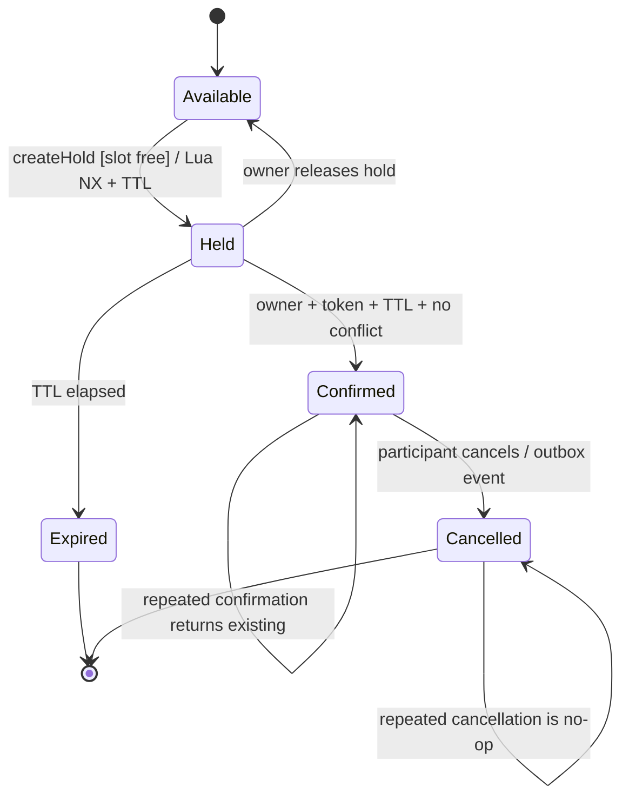
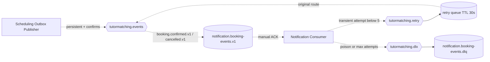
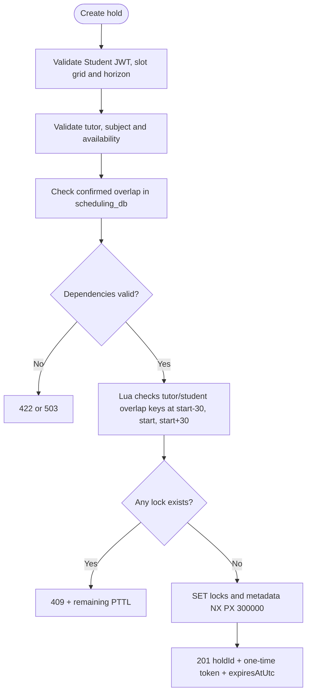
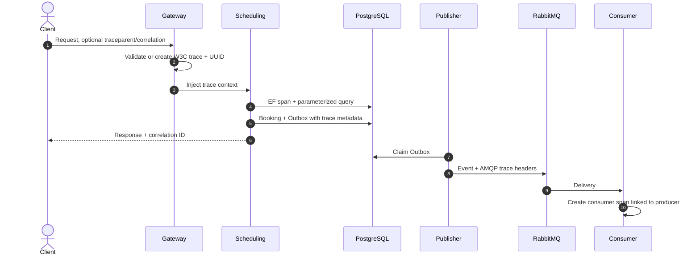

# Sơ đồ trạng thái và hạ tầng

## Booking lifecycle

Nguồn: [`booking-state.puml`](booking-state.puml).

## RabbitMQ topology

Nguồn: [`rabbitmq-topology.puml`](rabbitmq-topology.puml).

## Redis atomic hold flow

Nguồn: [`redis-hold-flow.puml`](redis-hold-flow.puml).

## Trace và correlation propagation

Nguồn: [`request-tracing.puml`](request-tracing.puml).

